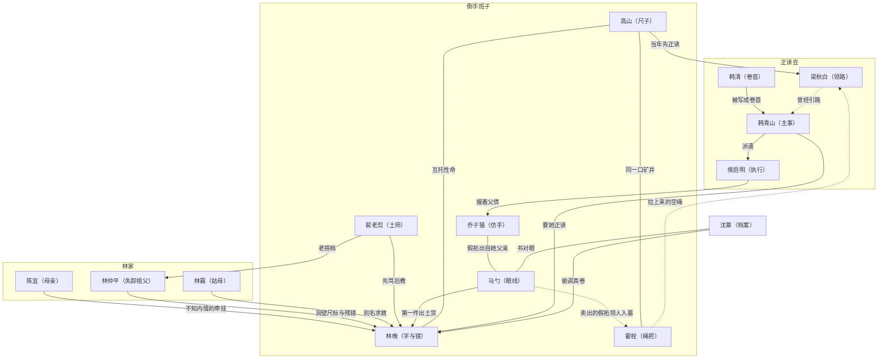

---

## 二、林晚手艺成长线

身世线告诉观众「她为什么被召来」，手艺线告诉观众「她凭什么活着出去」。两条并行，手艺线必须每卷都有一个看得见的动作节点，终局的第三种读法要让观众觉得是这一趟趟墓攒出来的。

| 阶段 | 卷 | 她会什么 | 看得见的节点 | 她还不会什么（留给下一阶段） |
| --- | --- | --- | --- | --- |
| 1 只会拓、会镜读 | 卷一 | 拓字、对镜读倒文；吓到了不喊，先拓，先系退路绳 | 第 1 集把灯先拴绳再放下去；第 5 集差点进假门，被高山拦下；第 9 集水涨到膝也先拓完祖父签名 | 分不清真假门；不会判断退路该走哪条 |
| 2 判断假门、留退路 | 卷二 | 看门轴锈流、看水痕判断真假舱门；第一个喊撤 | 第 18 集半张名册没拓完就喊撤；第 23 集凭门轴下的锈流认出真舱门 | 只会躲机关，不会解机关 |
| 3 主动写倒文解缝 | 卷三 | 在高山量好、霍栓楔好的前提下，写一行倒文让枋缝「回正」 | 第 38 集写倒文，缝开一线，三人一起撑 | 遇到对家只会逃 |
| 4 抢路时用行规压对家 | 卷四至卷七 | 把行规当武器：不盗新葬、生名碑不可动、先留退路、灯不尽不贪。行里人信这个，对家的散工也信 | 第 51 集喊「不盗新葬」，侯启明雇的散工当场撂铲；第 72 集在沙窗读秒里逼对家共用一条退路绳；第 85 集用「明器可取，取哪件有规矩」让侯启明的人自己踩翻板；第 99 集一句「生名碑不可动」，碑林里一半的铲子停了 | 还不是领班，关键判断仍靠别人 |
| 5 领班，第三种读法 | 卷八至卷十 | 自己定灯距、定谁先下、定什么时候弃货；最后才动字 | 第 108 集改用灯距量天井；第 129 集认出旧署和西坝是同一套排水；第 140 集起分金、排水、灯距、留路、弃印五样全用上；第 146 集第三种读法只是收尾那一锤 | —— |

林晚的口头动作：遇险先摸挎包里的拓纸卷、再摸手镜，最后才看人。这个顺序在卷十要反过来——先看人。

---

## 三、笑点岗位

笑点钉死在岗位上，每卷至少让每个岗位干一次活。所有笑点都跟在一个真实的危险后面。

| 人 | 岗位 | 怎么笑 | 什么时候突然不好笑 |
| --- | --- | --- | --- |
| 马勺 | 贪生怕死，嘴硬 | 怕死的话说得特别真：「我这条命是租的，押金还没退。」嘴上说不下，脚已经跟下去 | 一碰到货，腔调全变，专业到吓人，三句话断代断真假 |
| 乔子猫 | 骗人骗墓骗自己 | 事后理直气壮：「我那叫预先修正。」被拆穿先夸拆穿的人眼力好 | 双面城里城不再信她的假，她第一次只能说真话 |
| 霍栓 | 话少，关键时刻一句又土又准 | 平时一个字：「摇。」关键时一句：「这土是馊的，有人上礼拜翻过。」 | 数绳信号数到少一下的时候，整个人僵住 |
| 侯启明 | 对家里的不正经 | 每卷一次「边吃边堵洞口」：卷一牛肉饼，卷二煎饼果子，卷三烤白薯，卷四素包子，卷五烤馕，卷六想咬一口陶点心，卷七凉月饼，卷八胡饼，卷九档案馆食堂饭盒 | 卷十他手里第一次什么都没有，空着手堵洞口——观众这时才真怕 |
| 林晚 | 冷幽默 | 吓到了不喊。别人喊「有东西」，她说「先看落款」；墓要塌了，她先拓完最后一个字，再说「可以跑了」 | 卷七被遗忘时，她第一次喊了一声别人的名字 |
| 高山 | 粉笔、短句 | 句子不超过十个字。要塌的地方照样画尺标。量完才骂一句，一卷最多一句 | 卷三说出「是我先读的」，七个字，说了一集 |
| 裴老剪 | 嘴损的老土师 | 马勺每卷问一次「要不要尝一口土」，他每卷换一句骂法 | 看见熟人的尺标在洞壁上时，不骂了 |

---

## 四、名字入石：只满额用三次

生名入石是世界规则，不删。但观众会对它疲劳，所以只做满三次，其余全部换成别的代价。

**满额使用的三次**

1. **林晚之名在西坝石门**（卷一起，卷六揭底）：召人。第 1 集从裂缝里看见门楣上的「林晚」，第 7 集油灯认名。卷六林霜承认是她刻的——求救，不是诅咒。
2. **林晚之碑被夺**（卷七至卷八）：被遗忘。照片变淡、姓名牌只剩「林」、陈宜叫女儿时顿了一拍。这是全剧唯一一次把「被忘」拍满。
3. **韩清在灾录卷首**（卷九至卷十）：被写成引子。韩青山全部行动的理由，终局「不要把我读完」。

**改成别的代价**

| 原来的「名字」点 | 改成 | 怎么拍 |
| --- | --- | --- |
| 高山之名在金沙井壁（卷五） | **失路** | 黑沙是铁砂，罗盘乱指，回流把他的粉笔尺标整排吃掉；他第一次量错，差点让马勺埋进沙里。之后他把定向交给林晚 |
| 高山在折骨廊正读（卷三） | **失声** | 夹层闷燃那一夜呛坏了嗓子，喊了一夜没人应；不是墓夺走的，是烟和喊 |
| 马勺乳名在身份牌和备用名册（卷三、卷七） | **失信** | 夹层里找到的不是他的名字，是盖着他摊印的假拓——当年测量队就是拿他卖出去的拓进的墓。他在夜市的信用和对霍栓的脸一起没了 |
| 马勺的摊（卷四至卷五） | **失货** | 正读会买空、砸空他的拓纸和账本，他的货变成别人的路标 |
| 乔子猫的假名被城认领（卷五至卷六） | **失信** | 双面城不再信她的任何假，她的假铭、假标、假招牌在城里一律失效，只能说真话 |
| 梁秋白的工牌（卷八） | **失路** | 她用测量杆顶住倒下的顶门石，把自己关在关的另一侧，一直到卷九才找到出路 |

---

## 五、人物：先喂熟九个人

### 收缩原则

观众先记住核心九人：**林晚、高山、马勺、霍栓、乔子猫、裴老剪、韩青山、梁秋白、沈篆**。家里只留**陈宜**；对家常驻喜剧压迫是**侯启明**。缺席但贯穿的只有三个名字：林仲平（手迹）、林霜（卷六出场）、韩清（终局开口）。夜市背景只留**赵三姐**和孩子**砖头**，不单独起戏。

**合并与延后**

| 原人物 | 去向 |
| --- | --- |
| 尹南枝（形家） | 并入裴老剪：老人年轻时跟形家学过看水口和分金，「形土不分家」 |
| 佟匣（器行） | 并入沈篆：档案员懂著录和谱系，和马勺的「眼」对打，一个靠书一个靠手 |
| 吴纸（实习生） | 并入沈篆：「不小心」把真卷调出来的人就是他自己 |
| 老邝（开石） | 并入霍栓：霍栓原是矿上的绳把兼开石，折骨廊那一夜是他拉的绳 |
| 岑霜桥（观念对手） | 理念并入梁秋白，「被封住的事必须正读」由她说；形制学识也给她 |
| 孟小满（乔子猫东家） | 并入侯启明：乔子猫父亲的债在侯启明手里，他边吃边算利息 |
| 刘爆（散班子） | 功能并入侯启明雇来的散工「炮手」，不起名，卷一蛮开一次，炸完即退场 |
| 铁蛋 | 删，侯启明一人足够 |
| 白桂 | 并入赵三姐：邻摊兼马勺前任，保管他的钥匙 |
| 顾青棠、方正 | 延后。第一季不立执法线，地面压力由陈宜、夜市和侯启明承担；第二季可启用 |
| 井敬、老影 | 删。双面城规矩由林霜讲，影读关时辰由高山测影 |
| 林伯渔、柳绣 | 删 |
| 乔石 | 只留名字和刀法，不出场 |

### 核心九人

**林晚**（女，28）倒手传人，起初不知道。黑发低挽，深灰大衣，卡其围巾，旧皮挎包，黄铜手提灯，后来常多一面手镜。说话短，下墓先问退路。吓到不喊，先拓字。马勺叫她「镜子」，她应。痛点：越会读，墓越把她当自己人；对母亲只能说是在加班画图。

**高山**（男，32）尺子。矿山测量出身，嗓子伤过，句子不超过十个字。短发，左眉浅疤，黑帆布夹克，腰间盘绳，折尺和粉笔不离身。在要塌的地方照样画尺标。量完才骂一句，一卷一句。痛点：折骨廊里他先正读，把梁秋白那队人留在了夹层。

**马勺**（男，35，户籍名马世勺）眼线，夜市销货。瘦，寸头，金边旧眼镜，偏大的棕色棉袄，保温杯不离手。怕死，怕黑，怕赵三姐，怕说真话，独独不怕假货和湿土锈。碰到货就像换了个人。痛点：他卖出去的拓，曾经把人领进墓里。

**霍栓**（男，41）绳把兼开石，外号井绳。原是矿上的人，和高山同一个队。肩宽，旧安全绳盘在身上，指节全是勒痕，烟只在地面上抽。口头禅「下面有气再摇」。恐高，却总第一个吊下去。痛点：折骨廊那一夜，他拉上来的绳那头是空的。从此数信号刻板到可笑，少一下就僵住。

**乔子猫**（女，22，名乔慈）仿手。假拓、假票、假碑额、假路标。齐耳发，指侧墨渍，旧校服外套当罩衣。嘴甜话假，手极稳。被拆穿后理直气壮。痛点：父亲乔石的债在侯启明手里，她的手一直在替别人刻；当年测量队手里的假拓，刀法是她父亲的。

**裴老剪**（男，70）最后的土师，兼看形，林仲平的老搭档。瘦高，棉帽，手上全是茧，洛阳铲的杆子摸得发亮。很少下到墓室，但盗洞口一定有他。嘴损，怕麻烦，反对一切神化，土只闻不尝。痛点：徒弟要么走了，要么跟了对家；他认得洞壁上林仲平的尺标。

**韩青山**（男，40）正读会主事。干净大衣，声音温和，袖中空白拓纸，进墓也不沾泥。不要金子，要把姐姐韩清从灾录卷首「读回来」。卷一卷二只闻其名、见其拓纸，第 28 集他的主张由侯启明传话落地，第 50 集本人现身。痛点在终陵：要救的人亲口说「不要把我读完」。

**梁秋白**（女，31）高山的旧搭档，矿上的尺子之一。剪发，深色工装，手腕上新旧绑痕叠着。折骨廊幸存，被正读会捡走，做过对家的领路人，也是正读会里最懂形制的人。她信「被封住的事就该正读，倒手骗了后人一千年」。对高山的「嗯」极其不耐烦，会替他把话说完，再说「你不是这么想的」。痛点：活着，却给对家引过路。

**沈篆**（男，58）市档案馆残卷室管理员，懂著录。花白寸发，青布马甲，白手套。紧张时就去整理已经很整齐的卷宗。和马勺对鉴：「书上说」对「手上说」。他常「不小心」把真卷调给林晚。痛点：守了一辈子「不在能写倒文的人面前开那扇门」，门还是开了。

### 家与对家常驻

**陈宜**（女，54）林晚的母亲，开小复印店，顺带卖旧地图复印件。不知倒手旧业，以为女儿在接难缠的测绘单。审高山像审女婿，问马勺「你是不是社会闲散」。她的店是对家查旧图的必经之地，所以她是全剧最晚知道、也最先被危险擦过的人。

**侯启明**（男，38）正读会的执行者，开路和收账的人。永远在吃，打盗洞都不耽误咀嚼。说话客气，下手准。手里攥着乔子猫父亲的债，雇过炮手蛮开。每卷一次「边吃边堵洞口」。痛点极淡：唯一一次停手，是卷十空着手的时候。

### 缺席但贯穿

- **林仲平**：上一辈倒手头，失踪。只在签名、洞壁尺标、残镜和札记里出现。为倒史司封过灾录，后来反悔。
- **林霜**：姑母，户籍已故，卷六在双面城反面出场。是她把「林晚」刻进石门求救。
- **韩清**：韩青山的姐姐，灾录卷首。只以轮廓和手迹出现，第 143 集第一次开口。

### 夜市背景

**赵三姐**（女，40）邻摊，卖旧铜镜和香火，马勺的前任，钥匙还在她那儿。第一面铜镜出自她摊上。一句话把英雄拉回人间：「你再彻夜不归，保温杯我替你扔了。」**砖头**（12）夜市孩子，第 1 集掠过，第 150 集捡到新拓。

---

## 六、人物关系图

写戏时必须咬住的几条线：

- **林晚与高山**：信任先于感情。他在她被遗忘时写「林晚还在」；她在他想再正读一次时按住他的手。
- **高山、霍栓、梁秋白**：同一口井里出来的三个人。一个读了，一个拉了空绳，一个活着站到了对面。卷三以后所有愧疚戏的底座。
- **马勺、乔子猫、霍栓**：一张假拓连起三个人——乔石刻的，马勺卖的，测量队拿着它下去了。卷三揭开，卷六还清。
- **马勺与沈篆**：吵着把文物课讲完的一对，一个靠手，一个靠书，谁都只信对方的眼力。
- **侯启明与乔子猫**：债主和欠债人，也是全剧最荒诞的一对拌嘴。
- **韩青山与韩清**：全剧最硬的悲剧。救人也可能是加害，怀念也可能是自私。
- **陈宜**：林晚所有勇敢的反光。
