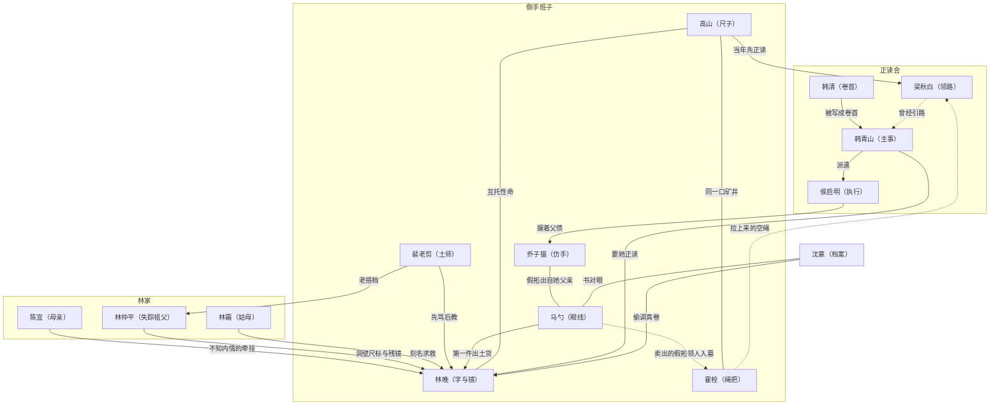

# 《反字墓》设定补完（第三版）

这是一部**盗墓探险**短剧的设定本。9:16 竖屏，每集 110–120 秒，只删场间过渡，不删【内行】和【钩】。十卷一百五十集，故事发生在北方河口城市津海。

找墓、打洞、下井、开石门、开棺、和对家抢路，是每一集都要看见的主菜。倒刻、镜读、生名入石，是这一套墓独有的规矩和杀招，只占每卷「三件套」里的一件，不许替代盗墓本身。

技法只写到戏里看得见、会用错、会惹祸的程度，写成判断题，不写成操作手册。人物、情节、名词全部原创，不借用既有盗墓小说的人物、情节和专有说法。尺度上：泥、锈、腐木、绳勒、霉味、积水、鼠群、黑暗都可以拍满；尸体与血只用气味、声音、人的反应和画外交代。

---

## 〇、创作纪律（三条，写每一集前先过一遍）

1. **先写怎么进、怎么险、怎么出，再写倒字为什么在这里发作。** 每卷开工先填「三件套」：找墓 / 形法，工程 / 独有死法，物证 / 古董。倒字系统只能是其中一件的放大器，不能是整卷高潮。一集里如果只有「读不读」，这一集就不合格。
2. **笑点跟在害怕后面。** 先让观众真觉得这人要死，再让马勺、乔子猫、霍栓说一句人话。没有怕在前面的笑，一律删。笑点钉在固定岗位上，靠反复干活顶出来，不靠金句。
3. **文物与风水必须是判断题。** 鉴定和看形不是科普插播，是「认错就灌沙，走错就夹死」。每卷至少两到三次「外行听不懂、内行一句戳穿」，由马勺、裴老剪、霍栓、乔子猫、高山、沈篆、梁秋白轮流出，不全堆给林晚的镜子。说完这句，下一秒就要有人因为它活下来，或者因为没听它出事。

附加的投产纪律：

- **每集结尾一个硬钩**：看得见的即时危险（绳断半股、灯苗发蓝、新铲土声、沙声、名字少一笔、有人没摇绳），不是一句悬念旁白。
- **地面集也要带险**：档案、回家、夜市这几类「歇气集」，必须同时有地下的东西追上来——新土锈、楼下打洞声、陌生人买走全部拓纸。
- **这行脏且亏**：每卷至少一次让观众闻到它——水棺味、霉炭、绳勒出血泡、指甲缝的土洗不掉、白干一趟只带出一身泥。
- **不再加新的「司、印、碑」概念。** 现有设定够用，往下加的只能是行当手感和人。

---

## 一、十卷三件套

每一卷都有一个别卷没有的死法。字系统那一栏写的是「只做什么」，超出这一栏就是越界。

| 卷 | 找墓 / 形法 | 工程 / 独有死法 | 物证 / 古董 | 字系统在这里只做什么 | 内行一句戳穿 |
| --- | --- | --- | --- | --- | --- |
| 一 反字陵（1–15） | 西坝泵站压在被填的旧河道上；五花土上叠一层新回填，两拨人动过 | **吃旧盗洞、塌券、耳室假门**：东汉砖室穹顶吐沙后整券落下，假门绕回死路 | 土锈未干的连弧纹铜镜；拓边纸是马勺自己卖出去的；金井里祖父的残镜 | 门楣上的「林晚」把她召来；旋门必须镜读才转 | 裴老剪：「底下花土是汉人的，上头这层松土是上个月的。新那拨回填不拍，底下是空的，谁踩谁下去。」／马勺：「锈是从铜里往外吃的，土咬在锈缝里，拇指蹭不掉——出土不过七天。」／高山：「真券横砌。这扇竖缝，后砌的。假门。」 |
| 二 沉钟渡（16–30） | 官图上的水口是假的，真水口在填掉的旧汊，看芦苇长成一溜 | **积炭闷灯、腐水棺上浮、水位涨封**：炭黑一搅灯先死，水棺顶住廊道，钟响一次水涨一尺 | 浸水漆牍名册见风即卷；乔子猫的假船票；倒挂钟的钟铭 | 钟铭镜听；对家逼林晚正读「开航」，乔子猫以假铭文顶替 | 裴老剪：「官图的水口画在桥下，那是修了桥以后的水。水口得有关有锁，两岸收得住。桥下那口两边敞着，是泄水，不是水口。」／霍栓：「灯苗发蓝、变矮，不是风，是没气。」／乔子猫：「收笔往回勾，左手刻的。我刻的。」 |
| 三 折骨廊（31–45） | 矿道是直的，汉墓是折的；矿渣里出现柏木屑，说明矿切进了题凑 | **题凑夹人、夹层闷燃**：柏木枋被矿震松，顺着压力像抽屉一样滑；木头在夹层里暗烧 | 铜缕玉衣残片：缕的材质定等级，缺片的方向是前人留的路标；枋木上的倒序编号 | 林晚第一次主动写倒文，帮高山和霍栓把缝撑开一线 | 高山：「头朝里是墙，尾朝外是缝。顺着尾走。」／马勺：「铜缕，这位身份不到顶。金井不在这一层。」／梁秋白：「直的是我们矿上打的，折的是汉人砌的。」 |
| 四 盲拓寺（46–60） | 寺压墓：塔基夯土里掺汉砖碎，先有墓后有塔 | **抽志塌层**：墓志被当成塔基的柱础和铺地，撬走一块，等于抽掉一层的托 | 墓志磨平改刻成经碑；伪拓靠纸边露馅；塔下一座近年的新葬 | 黑布蒙碑只用一次；林晚把拓下的名单「写哑」 | 马勺：「字口里没一点锈，石面全是锈。旧石新字，墓志改的经。」／裴老剪：「这块是柱础，底下压着一层地宫。你撬的是楼板。」／乔子猫：「笔势能仿，纸边仿不了。旧拓的毛边吃过墨，是黑的。」 |
| 五 金沙回流（61–75） | 黑沙是铁砂，罗盘在这里会说谎；沙下一指硬就是夯边 | **积沙回灌倒计时**：回流窗口一开一合，画面上始终挂着沙窗的读秒 | 河西一砖一画的画像砖；假古河图；干井井砖上的新旧刻 | 马勺被逼认出新刻的假倒文；认错就灌沙 | 裴老剪：「沙里下普通铲，带上来的全是沙。换掏沙铲。」／霍栓：「沙流起来像米倒进缸。听见米声，数到一百就得出来。」／马勺：「新刻的字口亮，老刻的口里有沙蚀的麻点。」 |
| 六 双面城（76–90） | 事死如事生放大成正反两套里坊：正面是生人陈设，反面是明器陈设 | **陈设错位**：明器灶、厕、仓、市楼和真屋位置对不上的地方就是机关——灶前闷坑缺氧，厕下渗井，仓下空，市楼翻板 | 陶灶、陶厕、陶仓、陶楼一套明器当地图用；后补的店招写错坊名 | 林霜说明石门上的名字是求救；林晚只在城心一口井边对拓一次 | 马勺：「陶厕连着猪圈，圈口朝哪，渗井就在哪。」／裴老剪：「仓底下该干。这片地砖返潮，下面是空的。」／乔子猫：「仿的人永远在地名上露馅——这块招牌把坊名写成了后来的。」 |
| 七 生名碑林（91–105） | 神道指路；家族墓按辈分排列，父居中，子孙分左右 | **挖错昭穆、串穴连塌**：同族墓道相连，挖错一座，两座一起塌；墓志盖底分离，名字失主 | 墓志的盖与底；挪过的石像生；风化碑 | 本卷是「被遗忘」的唯一满额使用：林晚的碑被夺 | 裴老剪：「左昭右穆。你挖的是孙辈的位，墓道跟爷爷的连着，一挖两塌。」／沈篆：「盖上写谁，底上写他这一辈子。盖底分开，名字就没主了。」／霍栓：「石人脸都朝路。这尊脸朝外，被挪过，路底下是新坑。」 |
| 八 影读关（106–120） | 唐墓依山，长斜坡墓道；天井是挖下去又填上的竖坑 | **天井坠人、自来石封门**：站在填土天井上会塌进去；石门一合，顶门石自己倒下，从里面推不开 | 被揭下又贴回的壁画；过洞里的灯台；石门门轴 | 影子里的字只给方向，不给路；林晚半正读之后总比镜像慢一拍 | 梁秋白：「天井填土比两边松。脚下声音发闷，你就站在天井上。」／马勺：「颜料是老的，地仗是新的。画被揭过，后面是空墙。」／霍栓：「门后有顶门石。门一合它就倒，先塞木楔。」 |
| 九 倒史司旧署（121–135） | 从档案馆地砖往下打：一层一个朝代 | **三层三种塌**：明清层暗沟沼气，宋金层仿木斗拱塌顶，汉层夯土管涌冒水 | 一枚印纽包浆偏一边的旧印；空白告身；灾录正文 | 印在选人；卷首是韩清，这是生名入石的第三处满额使用 | 裴老剪：「灰砖碎是明清，沟纹砖是宋金，夯窝是汉。夯窝一出，就到底了。」／马勺：「印纽一边厚一边薄。没用过的印不会这样，这是常年被人摸的。」／高山：「同一套排水。坡度一样。通西坝。」 |
| 十 无正面（136–150） | 分金是反的：罗盘读正南，门在镜像位 | **潮汐封陵、灯尽即封**：终陵在津海潮线以下，涨潮封道，低处缺氧；只能从倒史司的古排水走 | 铅芯包铜的印，比看上去重一半；卷一的那面残镜 | 第三种读法只是最后一锤；前面全靠分金、排水、灯距、留路、弃印 | 霍栓：「灯离地一尺还亮，离地一拳就暗。低处的气先死，走高。」／马勺：「这印铅芯的。揣着它，你游不出去。」／林晚：「门在镜像位。罗盘读南，脚往北偏三度。」 |

### 每卷一句话：别卷没有的死法

1. 反字陵：塌券埋退路，耳室假门绕回死路。
2. 沉钟渡：炭黑糊灯，水棺顶廊，钟响水涨。
3. 折骨廊：题凑枋木像抽屉一样把人夹进墙，夹层闷燃。
4. 盲拓寺：撬一块墓志，塌一层地宫。
5. 金沙回流：沙窗读秒，一过就灌死。
6. 双面城：明器陈设错位，站错一间屋就是闷坑、渗井或翻板。
7. 生名碑林：挖错辈分，串穴连塌；盖底分离，人被忘。
8. 影读关：天井坠人，顶门石封门。
9. 倒史司旧署：一层一个朝代，一层一种塌——沼气、斗拱、管涌。
10. 无正面：潮汐封陵，灯尽即封，只能从排水走。

---

## 二、林晚手艺成长线

身世线告诉观众「她为什么被召来」，手艺线告诉观众「她凭什么活着出去」。两条并行，手艺线必须每卷都有一个看得见的动作节点，终局的第三种读法要让观众觉得是这一趟趟墓攒出来的。

| 阶段 | 卷 | 她会什么 | 看得见的节点 | 她还不会什么（留给下一阶段） |
| --- | --- | --- | --- | --- |
| 1 只会拓、会镜读 | 卷一 | 拓字、对镜读倒文；吓到了不喊，先拓，先系退路绳 | 第 1 集把灯先拴绳再放下去；第 5 集差点进假门，被高山拦下；第 9 集水涨到膝也先拓完祖父签名 | 分不清真假门；不会判断退路该走哪条 |
| 2 判断假门、留退路 | 卷二 | 看门轴锈流、看水痕判断真假舱门；第一个喊撤 | 第 18 集半张名册没拓完就喊撤；第 23 集凭门轴下的锈流认出真舱门 | 只会躲机关，不会解机关 |
| 3 主动写倒文解缝 | 卷三 | 在高山量好、霍栓楔好的前提下，写一行倒文让枋缝「回正」 | 第 38 集写倒文，缝开一线，三人一起撑 | 遇到对家只会逃 |
| 4 抢路时用行规压对家 | 卷四至卷七 | 把行规当武器：不盗新葬、生名碑不可动、先留退路、灯不尽不贪。行里人信这个，对家的散工也信 | 第 51 集喊「不盗新葬」，侯启明雇的散工当场撂铲；第 72 集在沙窗读秒里逼对家共用一条退路绳；第 85 集用「明器可取，取哪件有规矩」让侯启明的人自己踩翻板；第 99 集一句「生名碑不可动」，碑林里一半的铲子停了 | 还不是领班，关键判断仍靠别人 |
| 5 领班，第三种读法 | 卷八至卷十 | 自己定灯距、定谁先下、定什么时候弃货；最后才动字 | 第 108 集改用灯距量天井；第 129 集认出旧署和西坝是同一套排水；第 136–145 集分金、排水、灯距、留路、弃印五样依次用上；第 146 集第三种读法只是收尾那一锤 | —— |

林晚的口头动作：遇险先摸挎包里的拓纸卷、再摸手镜，最后才看人。这个顺序在卷十要反过来——先看人。

---

## 三、笑点岗位

笑点钉死在岗位上，每卷至少让每个岗位干一次活。所有笑点都跟在一个真实的危险后面。

| 人 | 岗位 | 怎么笑 | 什么时候突然不好笑 |
| --- | --- | --- | --- |
| 马勺 | 贪生怕死，嘴硬 | 怕死的话说得特别真：「我这条命是租的，押金还没退。」后几卷轮换变体，不重复原句：「这命是分期的，这期还没还上。」「这命是借的，到期了人家要收回。」「利息比本金高，我提前走不划算。」「房东刚托梦，说租期到今晚。」「押金还在赵三姐那儿押着。」嘴上说不下，脚已经跟下去 | 一碰到货，腔调全变，专业到吓人，三句话断代断真假 |
| 乔子猫 | 骗人骗墓骗自己 | 事后理直气壮：「我那叫预先修正。」被拆穿先夸拆穿的人眼力好 | 双面城里城不再信她的假，她第一次只能说真话 |
| 霍栓 | 话少，关键时刻一句又土又准 | 平时一个字：「摇。」关键时一句：「这土是馊的，有人上礼拜翻过。」 | 数绳信号数到少一下的时候，整个人僵住 |
| 侯启明 | 对家里的不正经 | 每卷一次「边吃边堵洞口」：卷一牛肉饼，卷二煎饼果子，卷三烤白薯，卷四素包子，卷五烤馕，卷六想咬一口陶点心，卷七凉月饼，卷八胡饼，卷九档案馆食堂饭盒 | 卷十他手里第一次什么都没有，空着手堵洞口——观众这时才真怕 |
| 林晚 | 冷幽默 | 吓到了不喊。别人喊「有东西」，她说「先看落款」；墓要塌了，她先拓完最后一个字，再说「可以跑了」 | 卷七被遗忘时，她第一次喊了一声别人的名字 |
| 高山 | 粉笔、短句 | 句子不超过十个字。要塌的地方照样画尺标。量完才骂一句，一卷最多一句 | 卷三说出「是我先读的」，七个字，说了一集 |
| 裴老剪 | 嘴损的老土师 | 马勺每卷问一次「要不要尝一口土」，他每卷换一句骂法 | 看见熟人的尺标在洞壁上时，不骂了 |

---

## 四、名字入石：只满额用三次

生名入石是世界规则，不删。但观众会对它疲劳，所以只做满三次，其余全部换成别的代价。

**满额使用的三次**

1. **林晚之名在西坝石门**（卷一起，卷六揭底）：召人。第 1 集从裂缝里看见门楣上的「林晚」，第 7 集油灯认名。卷六林霜承认是她刻的——求救，不是诅咒。
2. **林晚之碑被夺**（卷七至卷八）：被遗忘。照片变淡、姓名牌只剩「林」、陈宜叫女儿时顿了一拍。这是全剧唯一一次把「被忘」拍满。
3. **韩清在灾录卷首**（卷九至卷十）：被写成引子。韩青山全部行动的理由，终局「不要把我读完」。

**改成别的代价**

| 原来的「名字」点 | 改成 | 怎么拍 |
| --- | --- | --- |
| 高山之名在金沙井壁（卷五） | **失路** | 黑沙是铁砂，罗盘乱指，回流把他的粉笔尺标整排吃掉；他第一次量错，差点把乔子猫埋进流沙。之后他把定向交给林晚 |
| 高山在折骨廊正读（卷三） | **失声** | 夹层闷燃那一夜呛坏了嗓子，喊了一夜没人应；不是墓夺走的，是烟和喊 |
| 马勺乳名在身份牌和备用名册（卷三、卷七） | **失信** | 夹层里找到的不是他的名字，是盖着他摊印的假拓——当年测量队就是拿他卖出去的拓进的墓。他在夜市的信用和对霍栓的脸一起没了 |
| 马勺的摊（卷四至卷五） | **失货** | 正读会买空、砸空他的拓纸和账本，他的货变成别人的路标 |
| 乔子猫的假名被城认领（卷五至卷六） | **失信** | 双面城不再信她的任何假，她的假铭、假标、假招牌在城里一律失效，只能说真话 |
| 梁秋白的工牌（卷八） | **失路** | 她用测量杆顶住倒下的顶门石，把自己关在关的另一侧，一直到卷九才找到出路 |

---

## 五、人物：先喂熟九个人

### 收缩原则

观众先记住核心九人：**林晚、高山、马勺、霍栓、乔子猫、裴老剪、韩青山、梁秋白、沈篆**。家里只留**陈宜**；对家常驻喜剧压迫是**侯启明**。缺席但贯穿的只有三个名字：林仲平（手迹）、林霜（卷六出场）、韩清（终局开口）。夜市背景只留**赵三姐**和孩子**砖头**，不单独起戏。

**合并与延后**

| 原人物 | 去向 |
| --- | --- |
| 尹南枝（形家） | 并入裴老剪：老人年轻时跟形家学过看水口和分金，「形土不分家」 |
| 佟匣（器行） | 并入沈篆：档案员懂著录和谱系，和马勺的「眼」对打，一个靠书一个靠手 |
| 吴纸（实习生） | 并入沈篆：「不小心」把真卷调出来的人就是他自己 |
| 老邝（开石） | 并入霍栓：霍栓原是矿上的绳把兼开石，折骨廊那一夜是他拉的绳 |
| 岑霜桥（观念对手） | 理念并入梁秋白，「被封住的事必须正读」由她说；形制学识也给她 |
| 孟小满（乔子猫东家） | 并入侯启明：乔子猫父亲的债在侯启明手里，他边吃边算利息 |
| 刘爆（散班子） | 功能并入侯启明雇来的散工「炮手」，不起名，卷一蛮开一次，炸完即退场 |
| 铁蛋 | 删，侯启明一人足够 |
| 白桂 | 并入赵三姐：邻摊兼马勺前任，保管他的钥匙 |
| 顾青棠、方正 | 延后。第一季不立执法线，地面压力由陈宜、夜市和侯启明承担；第二季可启用 |
| 井敬、老影 | 删。双面城规矩由林霜讲，影读关时辰由高山测影 |
| 林伯渔、柳绣 | 删 |
| 乔石 | 只留名字和刀法，不出场 |

### 核心九人

**林晚**（女，28）倒手传人，起初不知道。黑发低挽，深灰大衣，卡其围巾，旧皮挎包（内藏手镜），黄铜手提灯，深色直筒裤，旧短靴。说话短，下墓先问退路。吓到不喊，先拓字。马勺叫她「镜子」，她应。痛点：越会读，墓越把她当自己人；对母亲只能说是在加班画图。

**高山**（男，32）尺子。矿山测量出身，嗓子伤过，句子不超过十个字。短发，左眉浅疤，黑帆布夹克，腰间盘绳，折尺和粉笔不离身，深灰工装裤，泥点劳保鞋。在要塌的地方照样画尺标。量完才骂一句，一卷一句。痛点：折骨廊里他先正读，把梁秋白那队人留在了夹层。

**马勺**（男，35，户籍名马世勺）眼线，夜市销货。瘦，寸头，金边旧眼镜，偏大的棕色棉袄，旧卡其裤，松垮运动鞋，保温杯不离手（第 28 集碎了，此后换成搪瓷缸子）。怕死，怕黑，怕赵三姐，怕说真话，独独不怕假货和湿土锈。碰到货就像换了个人。痛点：他卖出去的拓，曾经把人领进墓里。

**霍栓**（男，41）绳把兼开石，外号井绳。原是矿上的人，和高山同一个队。肩宽，旧安全绳盘在身上，指节全是勒痕，洗旧工装裤，胶底劳保靴，烟只在地面上抽。口头禅「下面有气再摇」。恐高，却总第一个吊下去。痛点：折骨廊那一夜，他拉上来的绳那头是空的。从此数信号刻板到可笑，少一下就僵住。

**乔子猫**（女，22，名乔慈）仿手。假拓、假票、假碑额、假路标。齐耳发，指侧墨渍，旧校服外套当罩衣，深色裤，旧帆布鞋。嘴甜话假，手极稳。被拆穿后理直气壮。痛点：父亲乔石的债在侯启明手里，她的手一直在替别人刻；当年测量队手里的假拓，刀法是她父亲的。

**裴老剪**（男，70）最后的土师，兼看形，林仲平的老搭档。瘦高，棉帽，手上全是茧，洛阳铲的杆子摸得发亮，深灰棉裤，旧解放鞋。很少下到墓室，但盗洞口一定有他。嘴损，怕麻烦，反对一切神化，土只闻不尝。痛点：徒弟要么走了，要么跟了对家；他认得洞壁上林仲平的尺标。

**韩青山**（男，40）正读会主事。干净大衣，深色长裤，干净皮鞋，声音温和，袖中空白拓纸，进墓也不沾泥。不要金子，要把姐姐韩清从灾录卷首「读回来」。卷一卷二只闻其名、见其拓纸，第 28 集他的主张由侯启明传话落地，第 50 集本人现身。痛点在终陵：要救的人亲口说「不要把我读完」。

**梁秋白**（女，31）高山的旧搭档，矿上的尺子之一。剪发，深色工装，手腕上新旧绑痕叠着，深色工装裤，劳保鞋。折骨廊幸存，被正读会捡走，做过对家的领路人，也是正读会里最懂形制的人。她信「被封住的事就该正读，倒手骗了后人一千年」。对高山的「嗯」极其不耐烦，会替他把话说完，再说「你不是这么想的」。痛点：活着，却给对家引过路。

**沈篆**（男，58）市档案馆残卷室管理员，懂著录。花白寸发，青布马甲，深灰裤，布鞋，白手套。紧张时就去整理已经很整齐的卷宗。和马勺对鉴：「书上说」对「手上说」。他常「不小心」把真卷调给林晚。痛点：守了一辈子「不在能写倒文的人面前开那扇门」，门还是开了。

### 家与对家常驻

**陈宜**（女，54）林晚的母亲，开小复印店，顺带卖旧地图复印件。干净过时的毛衣，深色裤子，家用棉鞋，老花镜挂胸前。不知倒手旧业，以为女儿在接难缠的测绘单。审高山像审女婿，问马勺「你是不是社会闲散」。她的店是对家查旧图的必经之地，所以她是全剧最晚知道、也最先被危险擦过的人。

**侯启明**（男，38）正读会的执行者，开路和收账的人。圆脸，厚羽绒服，运动裤，干净运动鞋。永远在吃，打盗洞都不耽误咀嚼。说话客气，下手准。手里攥着乔子猫父亲的债，雇过炮手蛮开。每卷一次「边吃边堵洞口」。痛点极淡：唯一一次停手，是卷十空着手的时候。

### 缺席但贯穿

- **林仲平**：上一辈倒手头，失踪。只在签名、洞壁尺标、残镜和札记里出现。为倒史司封过灾录，后来反悔。
- **林霜**：姑母，户籍已故，卷六在双面城反面出场。是她把「林晚」刻进石门求救。
- **韩清**：韩青山的姐姐，灾录卷首。只以轮廓和手迹出现，第 143 集第一次开口。

### 夜市背景

**赵三姐**（女，40）邻摊，卖旧铜镜和香火，马勺的前任，钥匙还在她那儿。齐耳烫发，深酒红罩衫，藏青围裙，灰袖套，旧棉裤，耐磨布鞋。第一面铜镜出自她摊上。一句话把英雄拉回人间：「你再彻夜不归，保温杯我替你扔了。」**砖头**（12）夜市孩子，旧棉服、棉裤、脏球鞋，第 1 集掠过，第 150 集捡到新拓。

### 定妆与资产（全片统一）

全片色调锁定为**当代北方港城冬夜**：冷湿、路灯偏暖，衣服以灰、褐、藏青、旧黑为主，三张主角定妆必须同属一部戏。保温杯画进马勺定妆（第 28 集碎后换成搪瓷缸子），粉笔与折尺画进高山定妆，旧皮挎包与手镜画进林晚定妆，不单独立项。下装与鞋必须入画。门楣倒刻「林晚」字形须在出片前锁定，并另备一版「晚」字多一笔，供第 13 集使用；镜面与门楣出片时拍空镜、空额，字形后期合成。

---

## 六、人物关系图

写戏时必须咬住的几条线：

- **林晚与高山**：信任先于感情。他在她被遗忘时写「林晚还在」；她在他想再正读一次时按住他的手。
- **高山、霍栓、梁秋白**：同一口井里出来的三个人。一个读了，一个拉了空绳，一个活着站到了对面。卷三以后所有愧疚戏的底座。
- **马勺、乔子猫、霍栓**：一张假拓连起三个人——乔石刻的，马勺卖的，测量队拿着它下去了。卷三揭开，卷六还清。
- **马勺与沈篆**：吵着把文物课讲完的一对，一个靠手，一个靠书，谁都只信对方的眼力。
- **侯启明与乔子猫**：债主和欠债人，也是全剧最荒诞的一对拌嘴。
- **韩青山与韩清**：全剧最硬的悲剧。救人也可能是加害，怀念也可能是自私。
- **陈宜**：林晚所有勇敢的反光。

---

## 七、行当：一趟活六步，每一步都写成会出事的判断

不写成手册，写成「这一步看错，下一秒会怎样」。

**望：看形找水。** 传统形家讲龙止、砂环、水界、堂聚。镜头只留观众看得懂的：山脊或旧河道在这里收住，左右有抱势，去水处有收口。津海是河口平地，真正的「龙」是被填掉的旧河道，所以西坝泵站压在反字陵上。由裴老剪出手。

- 看错的后果：把「像太师椅」的地形直接当穴，挖到的是陪葬坑；跟着官图找水口，找到的是修桥以后的水。
- 裴老剪的口头禅：「寻龙三年，点穴十年。你们想一晚上点中，那是看电影。」

**问：货从哪来。** 夜市先于墓出现。一件土锈还湿的货，本身就是盗洞的方向。马勺问土锈是哪一片的、谁经的手；林晚和沈篆查旧图，官图上的空白往往是被收走的地方。

- 看错的后果：跟着一件做旧的饵货走，走进对家早就挖好的坑。

**量：分金定向。** 罗盘落到很细的度数上，差一度，长墓道里就偏出一个身位。高山把中线落到地面：折尺、粉笔、测线。倒刻墓的分金是反的：罗盘读正南，门在镜像位。

- 看错的后果：唐墓长墓道里偏一度，就从过洞走到天井上；河西黑沙是铁砂，罗盘会说谎。

**探：洛阳铲看土。** 洛阳铲是近代出现的半圆筒形探铲，后来也为考古钻探所用。由裴老剪主责。镜头只看三件事：带上来一筒土，纵向掰开看断面，看颜色、密度、包含物。

| 名称 | 看上去 | 在戏里意味着什么 |
| --- | --- | --- |
| 生土 | 层次清楚，颜色匀 | 这下面没墓，或还没打到墓口 |
| 熟土 | 松、杂，颜色不匀 | 有人动过：可能是墓，也可能是近代扰坑 |
| 五花土 | 多种颜色揉在一起，合不回原层 | 典型墓葬回填 |
| 夯土 | 密、硬，一层层砸过 | 墓壁、夯圈或陵台 |
| 新回填 | 压在五花土上，松，带近代杂物 | 又一拨人刚来过；不拍实的回填下面是空腔 |
| 包含物 | 木炭渣、夯窝、碎砖、铜锈、漆皮 | 断年代、断有没有人先到 |

裴老剪只闻不尝。马勺每卷问一次「要不要尝一口」，他每卷换一句骂法。

- 看错的后果：五花土只说明「有墓」，不说明「能进」。铲刃从密土忽然一空，必须停：下面是腔。新回填下面的腔随时会塌。

**开：进墓。** 竖穴用绳吊，砖室从券顶或旧盗洞穿，水墓从废井和排污口下潜，矿墓从矿道切口进，寺墓从塔基进。霍栓先探气再摇绳。石门要三个人对上：高山卡门，霍栓下楔，林晚读门楣。

- 吃旧洞还是打新洞，是每卷第一个判断题。旧洞塌过的地方已经塌完，新洞还没塌。
- 开棺比开门更险：空棺、疑棺、腐水棺，揭盖就进水、进沙、进气。

**收：取货与退。** 金银明器可取，生名碑不可动，倒文不是货。马勺决定哪些能带出去、哪些见风就毁。贪这一步，灯就尽了。对家常在收工时堵退路。

### 行规四条（写进冲突，不写成口号）

1. 只镜读，不正读。
2. 金银明器可取，生名碑不可动。
3. 进墓先留退路，灯不尽不贪。
4. 不盗新葬；年代不清的，先探再进。

行规不只是林晚的道德，是这一行的共同迷信。卷四起，林晚学会在对家面前喊行规：散工、炮手、甚至侯启明自己，都有不敢破的那一条。

倒刻墓里不喊全名。马勺给每个人起外号：林晚叫「镜子」，高山叫「粉笔」，霍栓叫「井绳」，乔子猫叫「猫」，他自己被叫「勺」。

### 墓里的险，按卷分配，不许重复当主死法

| 险 | 主场 | 其余卷只能做什么 |
| --- | --- | --- |
| 吃旧盗洞、塌券、耳室假门 | 卷一 | 旧洞可以出现，但不是死法 |
| 积炭闷灯、腐水棺、水位涨封 | 卷二 | 卷十的潮汐是「封」，不是「涨」，靠排水解 |
| 题凑夹层、闷燃 | 卷三 | 不再出现 |
| 抽志塌层 | 卷四 | 不再出现 |
| 积沙回灌读秒 | 卷五 | 不再出现 |
| 明器陈设错位（闷坑、渗井、翻板） | 卷六 | 翻板不在其他卷当主死法 |
| 串穴连塌、盖底分离 | 卷七 | 不再出现 |
| 天井坠人、顶门石封门 | 卷八 | 不再出现 |
| 沼气、斗拱塌顶、管涌 | 卷九 | 不再出现 |
| 潮汐封陵、低处缺氧 | 卷十 | 灯距判断在卷二埋过一次伏笔 |

墓中生物只用真实的：鼠群（卷一）、蝙蝠（卷八）、河底的泥鳅和水蛇（卷二）。不造怪物。

---

## 八、文物：每件货都是一道生死判断

马勺靠眼和手，沈篆靠著录，乔子猫看「这假是怎么做出来的」，林晚看字。同一件东西结论可以相反，这就是戏。四层判断：形制、工艺、使用痕迹和土锈、文字与制度。

**出土货第一课。** 真出土的东西，锈和土咬在一起，有潮气、棺木味；漆皮见风发皱。假出土是做上去的：浮锈、匀土、烤出来的旧色。夜市摊上一夜之间多出的「熟货」，说明附近有班子刚收工。

| 物件 | 内行看什么 | 看错会怎样 | 主场 |
| --- | --- | --- | --- |
| 铜镜 | 汉镜厚，连弧纹，铭文多在镜缘，常见「长宜子孙」一类吉语；唐镜薄，花卉瑞兽满。真锈从铜里一层层往外吃，土咬进锈缝；假锈浮在面上。锈分两色说明埋过两回 | 把饵镜当真货，跟着走进对家的坑 | 卷一、卷十 |
| 拓片 | 纸的帘纹、墨色、毛边。旧拓毛边吃过墨，是黑的；伪拓笔势可仿，纸边仿不了 | 跟着伪拓下墓，路是别人画的 | 卷一、卷四 |
| 漆牍 | 浸水漆器出水几口气就卷 | 硬拓会毁掉唯一的名册，只能记 | 卷二 |
| 玉衣残片 | 文献记载玉衣按身份分金缕、银缕、铜缕；汉代两头对钻的孔口微歪，仿不出 | 认错等级，就在陪葬室里找金井 | 卷三 |
| 墓志 | 魏晋以后墓志入土，有盖有底，盖题名、底记生平。改刻经碑的，字口无锈、石面全锈 | 把墓志当石料撬，等于抽掉托层；盖底分开，名字失主 | 卷四、卷七 |
| 画像砖 | 河西一砖一画，彩绘见风褪 | 抢砖不抢路，沙窗就过了 | 卷五 |
| 明器 | 陶灶、陶仓、陶井、陶厕、陶楼是给死人用的「家」；摆放方位就是墓主的起居图 | 站在明器所指的灶前、厕下、仓底，就是站在机关上 | 卷六 |
| 石像生 | 神道两侧，脸朝路 | 被挪过的石像生下面是新坑 | 卷七 |
| 壁画 | 唐墓墓道、过洞、天井常见出行仪仗；揭取过的壁画地仗是新的 | 把揭贴过的壁画当原墙，后面是空腔 | 卷八 |
| 印 | 印纽包浆偏一边，说明常年被同一只手摸 | 揣着铅芯印下水，游不出去 | 卷九、卷十 |

**马勺一眼断货的三句定式**（每卷用一次，换物件不换节奏）：先摸锈——「锈往里吃还是往外浮」；再闻——「是棺木味还是醋味」；最后看边——「边上是土还是胶」。说完这三下，他的腿才开始抖。

---

## 九、各朝形制：形制决定怎么进、会死在哪

| 时期 | 真实形制要点 | 本剧借来做什么 |
| --- | --- | --- |
| 商周 | 竖穴土坑木椁，墓道数量显等级 | 卷九最底层偶尔露出；竖穴必须绳吊 |
| 战国 | 大型木椁，常积石积炭防潮 | 卷二河底的积炭层：水一冲，炭黑糊灯 |
| 西汉 | 王侯可用黄肠题凑：柏木枋一头向内垒成墙；也有凿山崖墓；有玉衣 | 卷三：枋木被矿震松，像抽屉一样滑出来夹人 |
| 东汉 | 砖室墓、穹窿顶，前堂后室加耳室；随葬陶灶、陶仓、陶楼等明器 | 卷一的骨架；卷六的明器陈设逻辑 |
| 魏晋南北朝 | 斜坡墓道砖室；禁碑之后墓志入土 | 卷四：墓志被后来的寺拿去当塔基石料 |
| 唐 | 依山为陵；贵族墓斜坡墓道、过洞、天井、壁画、石门、墓志 | 卷八：天井坠人，石门后有顶门石 |
| 河西魏晋至唐 | 斜坡墓道、一砖一画的画像砖、积沙掩埋 | 卷五：沙窗读秒 |
| 宋金 | 仿木结构砖室，砖雕斗拱，家族墓地 | 卷七的家族排列；卷九中层的斗拱塌顶 |
| 明清 | 官署与地宫，前朝后寝 | 卷九顶层：地砖下暗沟积沼气 |

十卷「这一趟怎么下」：

1. **反字陵**（东汉砖室）：吃林仲平的旧盗洞进；塌券封退路；耳室假门；对家另打新洞；从塌稳的旧洞抢出。
2. **沉钟渡**（渡口丛葬，下层战国积炭）：废井下潜；炭黑糊灯；腐水棺顶廊；钟响水涨；从排污口出。
3. **折骨廊**（西汉题凑被矿脉切开）：吊矿井进；枋木夹人；夹层闷燃；从矿车斜井出。
4. **盲拓寺**（唐塔地宫压北朝墓）：从塔基打洞进；抽志塌层；新葬不可盗；塔倒之前爬出。
5. **金沙回流**（河西斜坡墓道与积沙墓）：沙窗开时进；读秒；沙灌之前用骆驼拖绳出。
6. **双面城**（明器陈设放大成正反里坊）：从沙下城门进；灶、厕、仓、市楼四处机关；从城心井出。
7. **生名碑林**（宋金家族墓地加跨朝碑志）：顺神道进；挖错辈分串穴连塌；扛着碑的拓影出。
8. **影读关**（唐式依山墓道）：斜坡墓道、过洞、天井一层层进；天井坠人；顶门石封门；从被揭过的壁画后面的旧洞出。
9. **倒史司旧署**（明清官署压宋金砖室压汉夯土）：从档案馆地砖往下打三层；沼气、斗拱、管涌；从排水暗渠出。
10. **无正面**（各朝形制倒着并用）：镜像位进；潮汐封陵；分金、排水、灯距、留路、弃印，最后一锤才是字；从西坝泵站的老排水口出——回到第一集的地方。

---

## 十、一卷里怎么配幽默、惊险、打动

- **惊险**：来自下墓本身，每卷那一种死法要连拍三集以上，让观众学会怕它。
- **幽默**：跟在惊险后面，按岗位出。
- **打动**：来自「救」与「不救」，也来自这行对自己的厌恶。林霜刻名是求救；韩青山正读是为了姐姐；高山想再读一次是为了夹层里的人；马勺发现自己卖出的拓领人进了墓；林晚不接印，是因为她听见了被救者的拒绝。感人戏写在选择上，不写在口号上。

### 入场节奏

| 集数 | 入场 | 观众要记住什么 |
| --- | --- | --- |
| 第 1 集 | 林晚、马勺、高山；赵三姐、砖头掠过 | 土锈未干的铜镜只作物证；林晚用手镜读拓片，当晚就站在裂缝上 |
| 第 2 集 | 裴老剪、霍栓 | 五花土上叠新回填：两拨人 |
| 第 7 集 | 侯启明（不报名） | 坐在棺上吃饼的对家 |
| 第 13 集 | 陈宜 | 女儿一身土回家，店里有人来复印西坝旧图 |
| 第 14 集 | 沈篆 | 档案楼底下有铲土声 |
| 第 19 集 | 乔子猫 | 侧廊硬挤在前，假票压在最后四十秒 |
| 第 28 集 | 韩青山的主张（侯启明传话） | 「东家不要金子，要你正着读一遍」 |
| 第 34 集 | 梁秋白 | 活着，站在对面 |
| 第 50 集 | 韩青山本人 | 不要金子，要一个人回来 |
| 第 78 集 | 林霜 | 刻名的人 |
| 第 143 集 | 韩清开口 | 「不要把我读完」 |
| 第 150 集 | 砖头捡到新拓 | 人间还在 |
